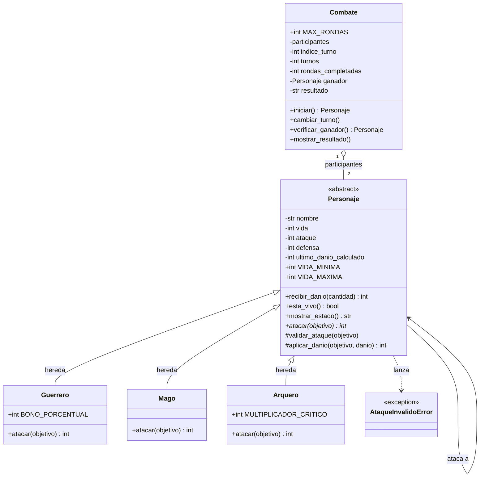

# Guardians of the Ancient Kingdom

Sistema de combate por turnos en Python, desarrollado con Programación Orientada a Objetos.

**Autor:** Emanuel · **Asignatura:** Programación Orientada a Objetos · **Proyecto:** Parcial II

---

## Contenido

1. [Descripción](#1-descripción)
2. [Estructura](#2-estructura)
3. [Clases](#3-clases)
4. [Relaciones entre clases](#4-relaciones-entre-clases)
5. [Conceptos de POO aplicados](#5-conceptos-de-poo-aplicados)
6. [Lógica del combate](#6-lógica-del-combate)
7. [Ejecución](#7-ejecución)
8. [Pruebas](#8-pruebas)
9. [Reto 1 — Diagrama de clases UML](#9-reto-1--diagrama-de-clases-uml)
10. [Reto 2 — Pruebas automatizadas con Pytest](#10-reto-2--pruebas-automatizadas-con-pytest)
11. [Reto de abstracción](#11-reto-de-abstracción)

---

## 1. Descripción

En el reino de Eldoria hay tres órdenes de guardianes: **Guerreros**, **Magos** y **Arqueros**. Todos tienen un nombre, puntos de vida, un valor de ataque y uno de defensa, pero cada orden pelea a su manera:

- El **Guerrero** pega más fuerte gracias a su fuerza (+20 % de ataque) y luego la defensa del enemigo le resta daño.
- El **Mago** lanza hechizos que atraviesan cualquier defensa.
- El **Arquero** aprovecha los puntos débiles del rival y duplica su daño cuando logra superar su defensa.

El programa resuelve el problema de **enfrentar a dos guardianes por turnos y decidir automáticamente quién gana**: calcula el daño de cada ataque según el tipo de personaje, actualiza la vida sin dejarla nunca por debajo de cero, controla de quién es el turno y termina el combate cuando alguien es derrotado o cuando el combate se estanca (empate).

## 2. Estructura

```text
Guardians-of-the-Ancient-Kingdom/
│
├── personajes.py        # Definición de las clases (no ejecuta nada al importarse)
├── main.py              # Crea objetos, ejecuta combates y los casos de prueba
├── README.md            # Esta documentación
└── test_personajes.py   # Pruebas automatizadas con Pytest (Reto 2)
```

| Archivo | Qué contiene y para qué se usa |
|---|---|
| `personajes.py` | Las clases `Personaje` (abstracta), `Guerrero`, `Mago`, `Arquero` y `Combate`, más la excepción `AtaqueInvalidoError`. Aquí están los constructores, los atributos encapsulados, los getters/setters, las validaciones y la lógica del juego. Solo *define* el sistema: si se importa, no imprime ni ejecuta nada. |
| `main.py` | Importa las clases de `personajes.py`, crea personajes, ejecuta ataques y combates y corre los 12 casos de prueba obligatorios (más 2 extra), mostrando por pantalla qué se comprobó y si salió bien. No repite ninguna implementación de clases. |
| `test_personajes.py` | Pruebas automatizadas con Pytest que verifican las reglas del sistema sin tener que revisar la pantalla a ojo. |
| `README.md` | Documentación del proyecto, el diagrama UML y la evidencia de los retos. |

## 3. Clases

**`Personaje` (abstracta).** Es la base de todos los guardianes. Guarda lo que tienen en común (nombre, vida, ataque y defensa) y se encarga de que esos datos siempre sean válidos. Además implementa lo que es igual para cualquiera: `recibir_danio()`, `esta_vivo()` y `mostrar_estado()`. Declara `atacar()` como método abstracto, porque cada orden ataca distinto. Como es abstracta, no se puede crear un `Personaje` directamente.

**`Guerrero`.** Hereda de `Personaje` y implementa `atacar()` con *Golpe poderoso*: sube su ataque un 20 % y después resta la defensa del objetivo.

**`Mago`.** Hereda de `Personaje` y implementa `atacar()` con *Hechizo penetrante*: el daño es exactamente su ataque, sin importar la defensa del rival.

**`Arquero`.** Hereda de `Personaje` y implementa `atacar()` con *Disparo crítico*: si su ataque supera la defensa del rival, el daño es el doble de la diferencia; si no, es cero.

**`Combate`.** Es una clase independiente que **organiza el enfrentamiento**: recibe dos personajes ya creados, lleva la cuenta de turnos y rondas, decide quién ataca (`cambiar_turno()`), revisa si ya hay un vencedor (`verificar_ganador()`), corre todo el combate (`iniciar()`) y presenta el desenlace (`mostrar_resultado()`). Los personajes se responsabilizan de sus propias acciones; el combate solo coordina.

**`AtaqueInvalidoError`.** Excepción propia que se lanza cuando un ataque no puede hacerse por el estado de los personajes (atacante derrotado, objetivo derrotado o ataque a sí mismo).

## 4. Relaciones entre clases

| Relación | Dónde aparece | Por qué se usó |
|---|---|---|
| **Herencia** ("es un") | `Guerrero`, `Mago` y `Arquero` **son** un `Personaje`. | Para no repetir en cada clase los atributos, las validaciones y los métodos que son iguales para todos. |
| **Asociación** ("usa a") | Cuando un personaje ejecuta `atacar(objetivo)`, interactúa con otro `Personaje` llamando a su `defensa` y a su `recibir_danio()`. Ninguno es dueño del otro: solo colaboran durante el ataque. | Cada objeto se hace cargo de lo suyo: el atacante calcula el daño y el objetivo decide cómo aplicarlo a su propia vida. |
| **Agregación** ("tiene a") | `Combate` **tiene** dos participantes, pero esos personajes se crean por fuera y le llegan al constructor. Si el combate termina, los personajes siguen existiendo (con su vida actualizada). | Porque un combate no "fabrica" a sus guardianes: solo los administra. Así los mismos personajes pueden usarse en otros contextos. |

Dos frases que me ayudaron a distinguirlas: *"un Guerrero **es un** Personaje"* (herencia) y *"un Combate **tiene** participantes"* (agregación).

## 5. Conceptos de POO aplicados

- **Abstracción.** `Personaje` define *qué* puede hacer cualquier guardián (atacar, recibir daño, estar vivo) sin decir *cómo* ataca cada uno. Se implementa con `ABC` y `@abstractmethod` sobre `atacar()` (`personajes.py`).
- **Encapsulamiento.** Los atributos son privados (`_nombre`, `_vida`, `_ataque`, `_defensa`) y solo se leen o cambian mediante *propiedades* (`@property` y `@x.setter`), que validan cada valor: nombre de texto no vacío, vida entera entre 0 y 100, ataque entero positivo y defensa entera no negativa. Datos inválidos lanzan `ValueError` o `TypeError`. Gracias a esto es imposible llegar a una vida de -30.
- **Herencia.** `Guerrero`, `Mago` y `Arquero` reciben de `Personaje` el constructor, las propiedades, `recibir_danio()`, `esta_vivo()`, `mostrar_estado()` y los auxiliares `_validar_ataque()` y `_aplicar_danio()`. Cada subclase solo escribe lo que la hace diferente: su `atacar()`.
- **Polimorfismo.** En `Combate._jugar_turno()` se ejecuta `atacante.atacar(defensor)` sin saber qué tipo de personaje es cada uno; Python ejecuta la versión que corresponde. En ninguna parte del combate hay un `if` que pregunte si alguien es Guerrero, Mago o Arquero.

## 6. Lógica del combate

### Cálculo del daño

| Clase | Fórmula | Ejemplo |
|---|---|---|
| `Guerrero` | `max(0, ataque × 1.20 − defensa del objetivo)`, redondeado hacia abajo | ataque 30 vs defensa 10 → 36 − 10 = **26** |
| `Mago` | `ataque` (ignora la defensa) | ataque 40 vs defensa 20 → **40** |
| `Arquero` | si `ataque > defensa`: `(ataque − defensa) × 2`; si no, `0` | ataque 35 vs defensa 15 → 20 × 2 = **40** |

Para el 20 % del Guerrero uso aritmética entera (`ataque * 120 // 100`) en lugar de multiplicar por `1.2`, así el redondeo hacia abajo es exacto y no depende de errores de decimales.

Antes de cualquier ataque, `_validar_ataque()` comprueba que el atacante esté vivo, que el objetivo esté vivo, que el objetivo sea un `Personaje` y que no sea el mismo atacante. Después, `_aplicar_danio()` se asegura de que el daño no sea negativo y se lo entrega al objetivo con `recibir_danio()`, que **no vuelve a restar la defensa** y deja la vida en 0 como mínimo. `atacar()` devuelve el **daño efectivo** realmente recibido (por eso en el último turno del ejemplo el Mago calcula 40 pero Arthas solo pierde los 20 puntos que le quedaban).

### Administración de los turnos

1. `Combate` guarda los dos participantes y un índice que dice a quién le toca atacar. El primer personaje recibido empieza.
2. En cada turno el atacante ataca al otro, se registra lo ocurrido (`historial`) y se muestra el estado de ambos.
3. Si el rival quedó derrotado, `verificar_ganador()` lo detecta y el combate termina con victoria. El derrotado nunca llega a atacar.
4. Si no, `cambiar_turno()` alterna el atacante.
5. Una **ronda** se completa cuando los dos han atacado una vez. Al cerrarse una ronda se revisan los empates:
   - **Empate técnico:** si en la ronda nadie causó daño.
   - **Empate por límite:** si se completan 50 rondas sin ganador.

## 7. Ejecución

**Requisitos:** Python 3.8 o superior. `main.py` no necesita librerías externas; solo las pruebas con Pytest requieren instalarlo.

```bash
# 1. Descargar el proyecto
git clone https://github.com/emanuelbarrigaoquendo-afk/parcial-2-poo
cd Guardians-of-the-Ancient-Kingdom

# 2. Ejecutar el programa y los casos de prueba
python main.py

# 3. (Opcional) Ejecutar las pruebas automatizadas
pip install pytest
pytest -v
```

En algunos sistemas el comando es `python3` en lugar de `python`. Si no se quiere usar `git`, también sirve descargar el repositorio como ZIP desde GitHub (**Code → Download ZIP**), descomprimirlo y ejecutar los mismos comandos dentro de la carpeta.

## 8. Pruebas

`main.py` ejecuta los 12 casos obligatorios (más 2 extra) y muestra en pantalla cada comprobación con `OK` o `FALLO`. Resultado de la ejecución:

| # | Caso comprobado | Resultado |
|---|---|---|
| 1 | Creación correcta de Guerrero, Mago y Arquero (y `Personaje` no se puede instanciar) |  Aprobado |
| 2 | Rechazo de vida mayor a 100 o negativa (constructor y setter) |  Aprobado |
| 3 | Rechazo de nombres vacíos, con solo espacios o que no son texto |  Aprobado |
| 4 | Rechazo de ataques (0, negativos, no enteros) y defensas (negativas, decimales) inválidos |  Aprobado |
| 5 | Habilidad del Guerrero: 30 vs 10 → 26; redondeo hacia abajo (33 vs 10 → 29) | Aprobado |
| 6 | Habilidad del Mago: ignora la defensa (40 vs 20 → 40; también contra defensa 500) |  Aprobado |
| 7 | Disparo crítico del Arquero: 35 vs 15 → 40; con ataque ≤ defensa → 0 |  Aprobado |
| 8 | La vida nunca es negativa: vida 20 + daño 50 → vida 0, daño efectivo 20 |  Aprobado |
| 9 | Un personaje derrotado no puede atacar ni ser atacado; tampoco se aceptan objetivos inválidos |  Aprobado |
| 10 | Combate completo Arthas vs Gandalf, turno a turno igual a la tabla del enunciado |  Aprobado |
| 11 | Identificación correcta del ganador: **Gandalf** | Aprobado |
| 12 | Combate sin daño termina en empate técnico tras 1 ronda |  Aprobado |
| Extra A | Empate por límite de 50 rondas (100 turnos, nadie muere) |  Aprobado |
| Extra B | Polimorfismo: la misma llamada `atacar()` da 26, 30 y 40 según la clase | Aprobado |

### Combate de ejemplo (salida real de `python main.py`)

```text
=== COMBATE: Arthas vs Gandalf ===
[Guerrero] Arthas - Vida: 100 | Ataque: 30 | Defensa: 20 | vivo
[Mago] Gandalf - Vida: 80 | Ataque: 40 | Defensa: 10 | vivo

Turno 1 (Ronda 1): Arthas ataca a Gandalf -> daño 26
   [Guerrero] Arthas - Vida: 100 | Ataque: 30 | Defensa: 20 | vivo
   [Mago] Gandalf - Vida: 54 | Ataque: 40 | Defensa: 10 | vivo

Turno 2 (Ronda 1): Gandalf ataca a Arthas -> daño 40
   [Guerrero] Arthas - Vida: 60 | Ataque: 30 | Defensa: 20 | vivo
   [Mago] Gandalf - Vida: 54 | Ataque: 40 | Defensa: 10 | vivo

Turno 3 (Ronda 2): Arthas ataca a Gandalf -> daño 26
   [Guerrero] Arthas - Vida: 60 | Ataque: 30 | Defensa: 20 | vivo
   [Mago] Gandalf - Vida: 28 | Ataque: 40 | Defensa: 10 | vivo

Turno 4 (Ronda 2): Gandalf ataca a Arthas -> daño 40
   [Guerrero] Arthas - Vida: 20 | Ataque: 30 | Defensa: 20 | vivo
   [Mago] Gandalf - Vida: 28 | Ataque: 40 | Defensa: 10 | vivo

Turno 5 (Ronda 3): Arthas ataca a Gandalf -> daño 26
   [Guerrero] Arthas - Vida: 20 | Ataque: 30 | Defensa: 20 | vivo
   [Mago] Gandalf - Vida: 2 | Ataque: 40 | Defensa: 10 | vivo

Turno 6 (Ronda 3): Gandalf ataca a Arthas -> daño 20 efectivo (calculado: 40)
   [Guerrero] Arthas - Vida: 0 | Ataque: 30 | Defensa: 20 | derrotado
   [Mago] Gandalf - Vida: 2 | Ataque: 40 | Defensa: 10 | vivo


RESULTADO FINAL

Ganador: Gandalf (Mago) con 2 punto(s) de vida restante(s).
Turnos jugados: 6 | Rondas completadas: 3
```

### Resumen final de `main.py`

```text

  RESUMEN

  Caso 1     APROBADO  (3/3 comprobaciones)
  Caso 2     APROBADO  (6/6 comprobaciones)
  Caso 3     APROBADO  (4/4 comprobaciones)
  Caso 4     APROBADO  (6/6 comprobaciones)
  Caso 5     APROBADO  (3/3 comprobaciones)
  Caso 6     APROBADO  (2/2 comprobaciones)
  Caso 7     APROBADO  (3/3 comprobaciones)
  Caso 8     APROBADO  (5/5 comprobaciones)
  Caso 9     APROBADO  (5/5 comprobaciones)
  Caso 10    APROBADO  (3/3 comprobaciones)
  Caso 11    APROBADO  (3/3 comprobaciones)
  Caso 12    APROBADO  (4/4 comprobaciones)
  EXTRA A    APROBADO  (3/3 comprobaciones)
  EXTRA B    APROBADO  (1/1 comprobaciones)

  Total: 51/51 comprobaciones aprobadas
```

## 9. Reto 1 — Diagrama de clases UML

**¿Qué es un diagrama de clases UML?** Es un plano del programa: muestra qué clases existen, qué datos (atributos) y qué operaciones (métodos) tiene cada una y cómo se relacionan entre sí, sin entrar en el código. Sirve para diseñar antes de programar y para explicar la arquitectura de forma visual. Está escrito con [Mermaid](https://mermaid.js.org/), que GitHub dibuja automáticamente en el README.



**Cómo leerlo:**

- Los símbolos `-`, `+` y `#` indican atributos/métodos privados, públicos y protegidos (de uso interno de la jerarquía). Los atributos privados se exponen mediante getters y setters (propiedades) con validación.
- `Personaje` está marcada como `<<abstract>>` y su método `atacar(objetivo)*` lleva asterisco porque es abstracto: las tres subclases están obligadas a implementarlo.
- La flecha con triángulo vacío (`<|--`) es la **herencia**: Guerrero, Mago y Arquero son un Personaje.
- La flecha simple de `Personaje` hacia sí misma es la **asociación**: un personaje interactúa con *otro* personaje cuando lo ataca.
- El rombo vacío (`o--`) entre `Combate` y `Personaje` es la **agregación**: el combate administra exactamente 2 personajes que existen de forma independiente.
- La línea punteada hacia `AtaqueInvalidoError` indica que los personajes dependen de esa excepción para avisar de ataques imposibles.

## 10. Reto 2 — Pruebas automatizadas con Pytest

**¿Qué es Pytest?** Es una librería de Python para escribir pruebas automáticas. Cada prueba es una función cuyo nombre empieza por `test_` y que usa `assert` para afirmar lo que *debería* pasar; Pytest las encuentra solas, las ejecuta todas y avisa cuál falló y por qué. La ventaja frente a ejecutar `main.py` y mirar los mensajes es que las pruebas son **repetibles y verificables**: cada vez que cambio el código puedo comprobar en un segundo que ninguna regla se rompió.

Las pruebas están en `test_personajes.py` y cubren:

- Creación de personajes válidos (los tres tipos, límites de vida 0 y 100).
- Rechazo de valores incorrectos (vida fuera de rango, nombres vacíos, ataques y defensas inválidos, tipos incorrectos, setters).
- Cálculo del daño de cada clase (incluyendo redondeo del Guerrero y los casos en que el Arquero no hace crítico).
- Que la vida nunca sea negativa.
- Que un personaje derrotado no pueda atacar ni ser atacado.
- Combates: ganador, tabla turno a turno del enunciado, empate técnico, empate por 50 rondas y validaciones del propio `Combate`.
- Que importar `personajes.py` no imprima ni ejecute nada.

**Cómo ejecutarlas:**

```bash
pip install pytest
pytest -v
```

**Resultado de la ejecución:**

```text
$ pytest -q
........................................................................ [ 96%]
...                                                                      [100%]
75 passed in 0.10s
```

<details>
<summary>Ver la salida completa de <code>pytest -v</code></summary>

```text
 test session starts 
platform linux -- Python 3.12.3, pytest-9.1.1, pluggy-1.7.0 -- /usr/bin/python3
collecting ... collected 75 items

test_personajes.py::test_creacion_valida[Guerrero] PASSED                [  1%]
test_personajes.py::test_creacion_valida[Mago] PASSED                    [  2%]
test_personajes.py::test_creacion_valida[Arquero] PASSED                 [  4%]
test_personajes.py::test_personaje_es_abstracta PASSED                   [  5%]
test_personajes.py::test_subclase_sin_atacar_no_se_puede_instanciar PASSED [  6%]
test_personajes.py::test_vida_en_los_limites_es_valida[0] PASSED         [  8%]
test_personajes.py::test_vida_en_los_limites_es_valida[1] PASSED         [  9%]
test_personajes.py::test_vida_en_los_limites_es_valida[100] PASSED       [ 10%]
test_personajes.py::test_nombre_se_limpia_de_espacios PASSED             [ 12%]
test_personajes.py::test_rechaza_vida_fuera_de_rango[-1-Guerrero] PASSED [ 13%]
test_personajes.py::test_rechaza_vida_fuera_de_rango[-1-Mago] PASSED     [ 14%]
test_personajes.py::test_rechaza_vida_fuera_de_rango[-1-Arquero] PASSED  [ 16%]
test_personajes.py::test_rechaza_vida_fuera_de_rango[-50-Guerrero] PASSED [ 17%]
test_personajes.py::test_rechaza_vida_fuera_de_rango[-50-Mago] PASSED    [ 18%]
test_personajes.py::test_rechaza_vida_fuera_de_rango[-50-Arquero] PASSED [ 20%]
test_personajes.py::test_rechaza_vida_fuera_de_rango[101-Guerrero] PASSED [ 21%]
test_personajes.py::test_rechaza_vida_fuera_de_rango[101-Mago] PASSED    [ 22%]
test_personajes.py::test_rechaza_vida_fuera_de_rango[101-Arquero] PASSED [ 24%]
test_personajes.py::test_rechaza_vida_fuera_de_rango[1000-Guerrero] PASSED [ 25%]
test_personajes.py::test_rechaza_vida_fuera_de_rango[1000-Mago] PASSED   [ 26%]
test_personajes.py::test_rechaza_vida_fuera_de_rango[1000-Arquero] PASSED [ 28%]
test_personajes.py::test_rechaza_nombre_vacio[-Guerrero] PASSED          [ 29%]
test_personajes.py::test_rechaza_nombre_vacio[-Mago] PASSED              [ 30%]
test_personajes.py::test_rechaza_nombre_vacio[-Arquero] PASSED           [ 32%]
test_personajes.py::test_rechaza_nombre_vacio[   -Guerrero] PASSED       [ 33%]
test_personajes.py::test_rechaza_nombre_vacio[   -Mago] PASSED           [ 34%]
test_personajes.py::test_rechaza_nombre_vacio[   -Arquero] PASSED        [ 36%]
test_personajes.py::test_rechaza_nombre_que_no_es_texto[123] PASSED      [ 37%]
test_personajes.py::test_rechaza_nombre_que_no_es_texto[None] PASSED     [ 38%]
test_personajes.py::test_rechaza_nombre_que_no_es_texto[4.5] PASSED      [ 40%]
test_personajes.py::test_rechaza_ataque_no_positivo[0] PASSED            [ 41%]
test_personajes.py::test_rechaza_ataque_no_positivo[-1] PASSED           [ 42%]
test_personajes.py::test_rechaza_ataque_no_positivo[-100] PASSED         [ 44%]
test_personajes.py::test_rechaza_defensa_negativa[-1] PASSED             [ 45%]
test_personajes.py::test_rechaza_defensa_negativa[-100] PASSED           [ 46%]
test_personajes.py::test_rechaza_tipos_incorrectos_en_numeros[10] PASSED [ 48%]
test_personajes.py::test_rechaza_tipos_incorrectos_en_numeros[3.5] PASSED [ 49%]
test_personajes.py::test_rechaza_tipos_incorrectos_en_numeros[None] PASSED [ 50%]
test_personajes.py::test_rechaza_tipos_incorrectos_en_numeros[True] PASSED [ 52%]
test_personajes.py::test_setters_aplican_las_mismas_validaciones PASSED  [ 53%]
test_personajes.py::test_guerrero_golpe_poderoso PASSED                  [ 54%]
test_personajes.py::test_guerrero_redondea_hacia_abajo PASSED            [ 56%]
test_personajes.py::test_guerrero_dano_minimo_cero PASSED                [ 57%]
test_personajes.py::test_mago_ignora_la_defensa PASSED                   [ 58%]
test_personajes.py::test_mago_con_defensa_enorme_hace_el_mismo_dano PASSED [ 60%]
test_personajes.py::test_arquero_disparo_critico PASSED                  [ 61%]
test_personajes.py::test_arquero_sin_critico_si_no_supera_la_defensa[10-15] PASSED [ 62%]
test_personajes.py::test_arquero_sin_critico_si_no_supera_la_defensa[15-15] PASSED [ 64%]
test_personajes.py::test_polimorfismo_misma_llamada_distinto_resultado PASSED [ 65%]
test_personajes.py::test_vida_nunca_queda_negativa PASSED                [ 66%]
test_personajes.py::test_recibir_danio_no_descuenta_defensa_otra_vez PASSED [ 68%]
test_personajes.py::test_recibir_danio_rechaza_negativos PASSED          [ 69%]
test_personajes.py::test_recibir_danio_rechaza_tipos_incorrectos PASSED  [ 70%]
test_personajes.py::test_ataque_que_supera_la_vida_deja_al_objetivo_en_cero PASSED [ 72%]
test_personajes.py::test_derrotado_no_puede_atacar[Guerrero] PASSED      [ 73%]
test_personajes.py::test_derrotado_no_puede_atacar[Mago] PASSED          [ 74%]
test_personajes.py::test_derrotado_no_puede_atacar[Arquero] PASSED       [ 76%]
test_personajes.py::test_no_se_puede_atacar_a_un_derrotado[Guerrero] PASSED [ 77%]
test_personajes.py::test_no_se_puede_atacar_a_un_derrotado[Mago] PASSED  [ 78%]
test_personajes.py::test_no_se_puede_atacar_a_un_derrotado[Arquero] PASSED [ 80%]
test_personajes.py::test_objetivo_invalido PASSED                        [ 81%]
test_personajes.py::test_mostrar_estado_describe_al_personaje PASSED     [ 82%]
test_personajes.py::test_combate_del_enunciado_gandalf_gana PASSED       [ 84%]
test_personajes.py::test_combate_coincide_turno_a_turno_con_la_tabla_del_enunciado PASSED [ 85%]
test_personajes.py::test_ultimo_golpe_registra_dano_calculado_y_efectivo PASSED [ 86%]
test_personajes.py::test_gana_el_primero_si_derrota_antes_al_segundo PASSED [ 88%]
test_personajes.py::test_gana_el_segundo_participante PASSED             [ 89%]
test_personajes.py::test_empate_tecnico_cuando_nadie_causa_dano PASSED   [ 90%]
test_personajes.py::test_empate_tras_50_rondas_sin_ganador PASSED        [ 92%]
test_personajes.py::test_cambiar_turno_alterna_el_atacante PASSED        [ 93%]
test_personajes.py::test_verificar_ganador_sin_ganador_y_con_ganador PASSED [ 94%]
test_personajes.py::test_combate_rechaza_participantes_invalidos PASSED  [ 96%]
test_personajes.py::test_combate_no_se_puede_iniciar_dos_veces PASSED    [ 97%]
test_personajes.py::test_combate_muestra_estado_despues_de_cada_ataque PASSED [ 98%]
test_personajes.py::test_importar_personajes_no_imprime_ni_ejecuta_pruebas PASSED [100%]

============================== 75 passed in 0.16s ==============================
```

</details>

## 11. Reto de abstracción

**¿Por qué `atacar()` debe ser abstracto, pero `recibir_danio()` puede estar implementado en la clase base?**

La respuesta sale de preguntarse **qué es igual para todos los personajes y qué cambia de uno a otro**.

**Qué responsabilidad tiene `Personaje`.** Representa a *cualquier* guardián del reino. Su trabajo es guardar el estado que todos comparten (nombre, vida, ataque, defensa), garantizar que ese estado siempre sea válido (vida entre 0 y 100, por ejemplo) y definir las acciones que cualquier guardián debe saber hacer. No es un personaje real: por eso es abstracta y no se puede instanciar.

**Qué comparten todos.** Todos tienen vida y todos pierden vida de la misma manera cuando reciben un golpe: se le resta el daño, la vida no baja de cero y se informa cuánto daño se recibió de verdad. También todos "están vivos" mientras su vida sea mayor que cero. Eso no depende de si el guardián es Guerrero, Mago o Arquero.

**Por qué `atacar()` es diferente en cada clase.** Cada orden tiene una forma distinta de calcular el daño. Con el mismo ataque de 30 contra una defensa de 10:

- `Guerrero` → `30 × 1.20 − 10 = 26`
- `Mago` → `30` (ignora la defensa)
- `Arquero` → `(30 − 10) × 2 = 40`

No existe un "ataque genérico" que tenga sentido para un `Personaje` en general: si escribiera uno en la clase base estaría inventando una regla que no pertenece a ningún guardián real, y una subclase nueva podría heredarlo por descuido sin definir su propia habilidad. Al marcarlo `@abstractmethod`, Python obliga a cada clase hija a escribir su versión (si una se olvida, ni siquiera se puede crear el objeto; lo comprobé en `test_subclase_sin_atacar_no_se_puede_instanciar`).

**Por qué `recibir_danio()` se puede reutilizar.** Su lógica es idéntica para todos y además es la que protege la regla más importante de integridad del programa: *la vida nunca queda negativa*.

```python
def recibir_danio(self, cantidad):
    ...
    danio_efectivo = min(cantidad, self._vida)
    self._vida -= danio_efectivo
    return danio_efectivo
```

Si esa lógica estuviera repetida en las tres subclases, bastaría que una tuviera un error para que, por ejemplo, un Arquero terminara con vida -30 mientras los demás no. Al estar una sola vez en `Personaje`, existe **una única fuente de verdad** y una sola prueba la verifica para los tres. Lo vimos en el último turno del combate de ejemplo: el Mago calcula 40 de daño, pero `recibir_danio()` solo descuenta los 20 puntos que le quedaban a Arthas y devuelve 20.

**Cómo se conecta con abstracción, herencia y polimorfismo.**

- **Abstracción:** `Personaje` dice *qué* puede hacer un guardián (`atacar`, `recibir_danio`, `esta_vivo`) y deja sin escribir *cómo* ataca cada uno.
- **Herencia:** `Guerrero`, `Mago` y `Arquero` reutilizan sin copiar `recibir_danio()`, `esta_vivo()`, las validaciones y los auxiliares `_validar_ataque()` y `_aplicar_danio()`. Solo escriben la fórmula de su ataque, que es lo único que de verdad los distingue.
- **Polimorfismo:** como todos garantizan tener `atacar()`, `Combate` puede hacer `atacante.atacar(defensor)` sin saber quién es quién:

```python
danio_efectivo = atacante.atacar(defensor)   # en Combate._jugar_turno()
```

  Por eso se podría añadir un nuevo guardián (por ejemplo, un `Sacerdote`) escribiendo solo una subclase con su propio `atacar()`, sin tocar una línea de `Combate`.

**En resumen:** lo que **cambia** entre personajes (la forma de atacar) se declara abstracto y cada clase lo resuelve a su manera; lo que **es igual** para todos (recibir daño) se implementa una sola vez en la base y se hereda.
